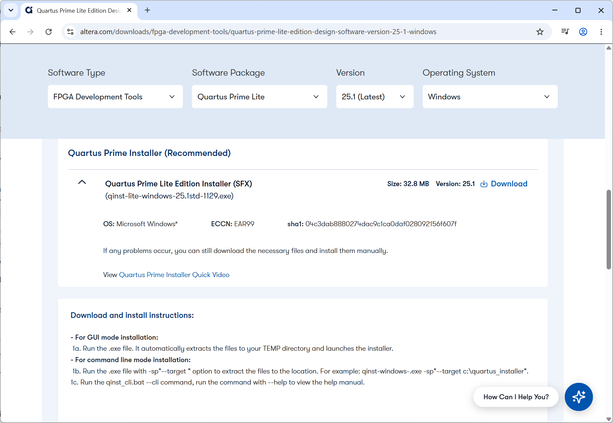
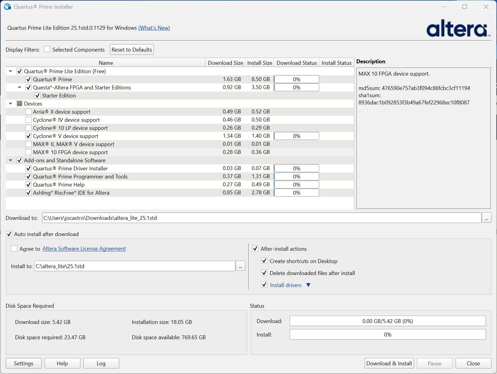
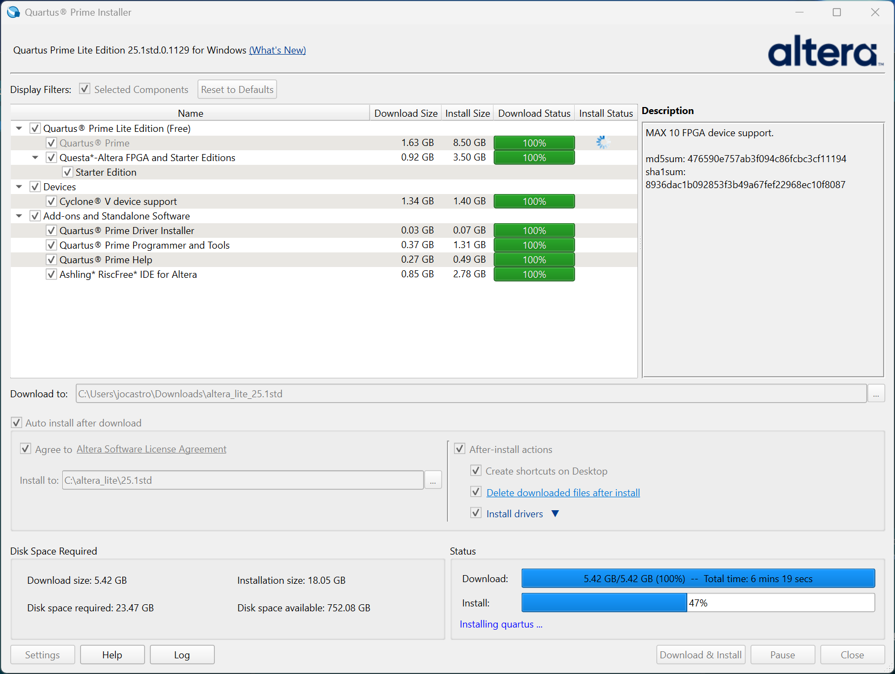
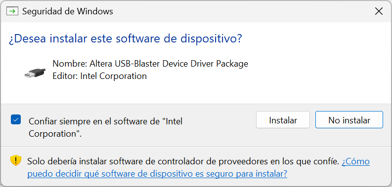
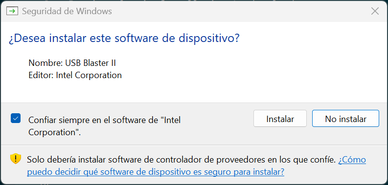
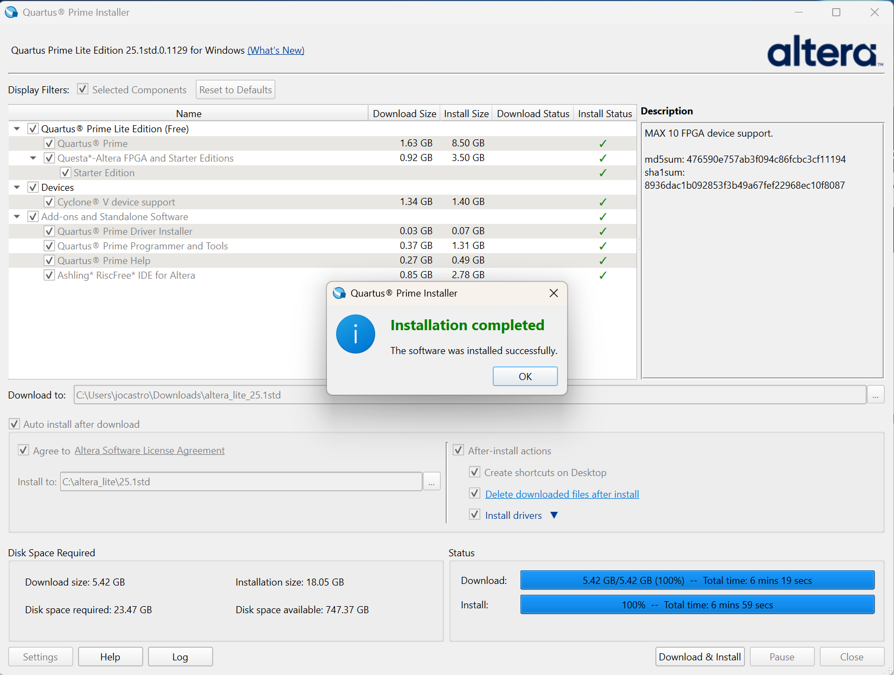

# Installing Altera Quartus Prime Lite 25.1

This guide explains how to install Quartus Prime Lite 25.1 on Windows and add support for Cyclone V devices.

## 1. Download the installer

Open the [official Quartus Prime Lite 25.1 download page for Windows](https://www.altera.com/downloads/fpga-development-tools/quartus-prime-lite-edition-design-software-version-25-1-windows). Sign in if prompted, then download **Quartus Prime Lite Edition Installer (SFX)**. Run the downloaded `.exe` file to launch the installer.

## 2. Select the components

Keep **Quartus Prime** and **Questa*-Altera FPGA and Starter Editions** selected. Under **Devices**, select only **Cyclone V device support**. Keep all items under **Add-ons and Standalone Software** selected.

Accept the license agreement. You can keep the default download and installation locations; make sure you have approximately **24 GB of free disk space**.

## 3. Download and install

Click **Download & Install** and wait for the download and installation to finish.

## 4. Install the drivers

If Windows prompts you to install the **Altera USB-Blaster Device Driver Package** and **USB Blaster II** drivers, select **Install** for each prompt. Then confirm that Quartus installation completed successfully.

