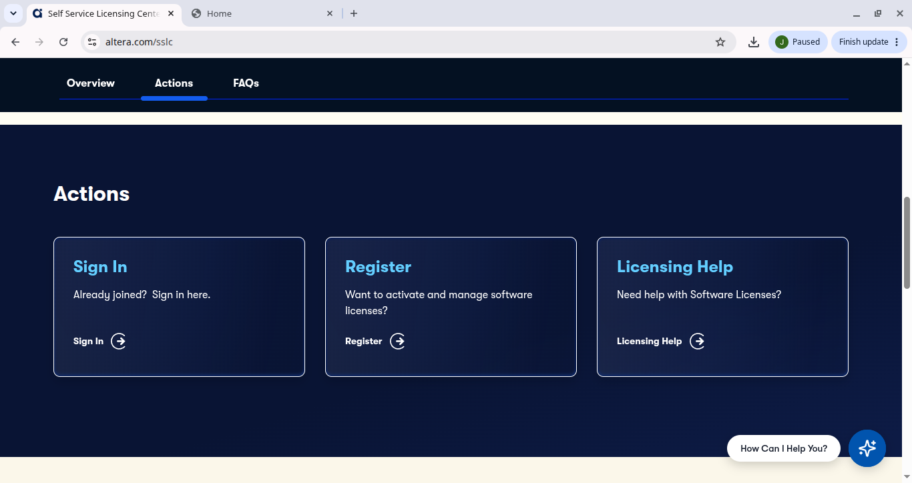
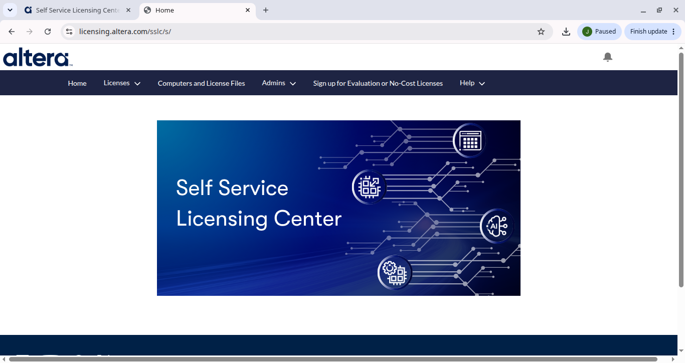
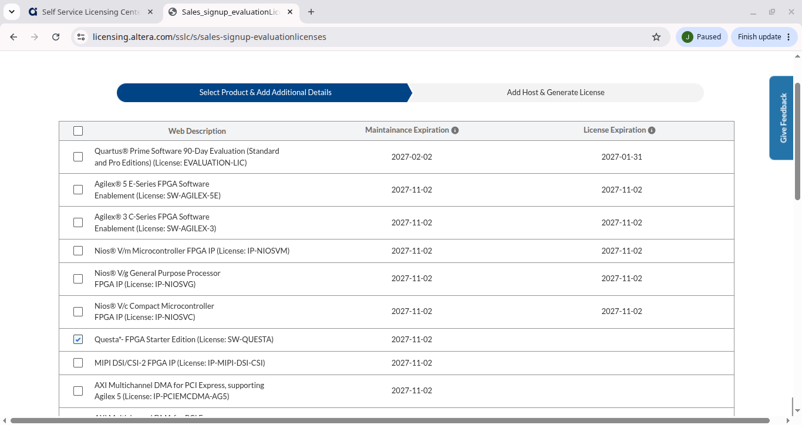

# Licensing Questa Altera FPGA Starter Edition (Linux and Windows)

Fixes this error:

```
Unable to find the license file. It appears that your license file environment variable (SALT_LICENSE_SERVER) is not set correctly.
Unable to checkout a license. Vsim is closing.
** Error: Invalid license environment. Application closing.
```

The free Starter Edition license is tied to your machine's NIC (MAC address). `SALT_LICENSE_SERVER` must point to the license file.

The process has three parts:

1. [Get your NIC ID](#1-get-your-nic-id): **different** on Linux and Windows.
2. [Request the license](#2-request-the-license-same-on-all-systems): **same** on all systems.
3. [Install the license](#3-install-the-license): **different** on Linux and Windows.

---

## 1. Get your NIC ID

Use the MAC address of your primary physical network adapter, **without separators** (12 hex digits). Use the same adapter when requesting the license.

### Linux

```bash
ip link
```

Use the MAC of the physical interface (e.g. `enp...` or `eth0`), removing the colons.

### Windows

Open Command Prompt and run:

```bat
ipconfig /all
```

Copy the **Physical Address** of your Ethernet or Wi-Fi adapter, removing the dashes. A disabled or virtual adapter can break the match.

---

## 2. Request the license (same on all systems)

### 2.1 Sign in to the Self Service Licensing Center

Go to <https://www.altera.com/sslc>, open **Actions**, and click **Sign In** (or **Register** if you have no account).



### 2.2 Open the no-cost licenses page

In <https://licensing.altera.com/sslc/s/>, click **Sign up for Evaluation or No-Cost Licenses**.



### 2.3 Select Questa Starter Edition

Check **Questa\*- FPGA Starter Edition (License: SW-QUESTA)** and continue to **Add Host & Generate License**. Add your computer using the NIC ID from step 1, then generate the license.



### 2.4 Download the license file

Altera emails you the license file (`LR-xxxxxx_License.dat`), or you can download it from **Computers and License Files**.

---

## 3. Install the license

### Linux

1. Save the file in a path of your choice, for example (supossing your Quartus installation is located in `$HOME/altera_lite`):

   ```
   $HOME$/altera_lite/license.dat
   ```

2. Set the environment variables:

   ```bash
   export SALT_LICENSE_SERVER="$HOME/altera_lite/license.dat"
   export PATH="$HOME/altera_lite/25.1std/questa_fse/bin:$PATH"
   ```

   Add both lines to `~/.bashrc` to make them permanent. For a license server, use `export SALT_LICENSE_SERVER=<port>@<hostname>` instead.

3. Verify:

   ```bash
   "$HOME/altera_lite/25.1std/questa_fse/linux_x86_64/lmutil" lmhostid -flexid
   vsim -version
   vsim
   ```

If `vsim` still fails, check that the path is correct, the file is readable, and the variable is exported in the same shell where you run `vsim`.

### Windows

1. Save the file in a path without spaces, for example:

   ```
   C:\altera_lite\license.dat
   ```

2. Set the environment variable:
   - Press Win, search for **Edit the system environment variables**, and click **Environment Variables...**.
   - Under **User variables**, click **New**:
     - Name: `SALT_LICENSE_SERVER`
     - Value: `C:\altera_lite\license.dat` (or `port@server` for a license server)

   Or from Command Prompt:

   ```bat
   setx SALT_LICENSE_SERVER "C:\altera_lite\license.dat"
   ```

   Optionally add the Questa `win64` folder to `PATH`, e.g. `C:\altera_lite\25.1std\questa_fse\win64`.

3. Close and reopen your terminal (or Questa), since the variable only applies to new processes, then verify:

   ```bat
   vsim -version
   vsim
   ```

If it fails, check that the NIC ID in the license matches `ipconfig /all`, the path is correct, and the license has not expired.
